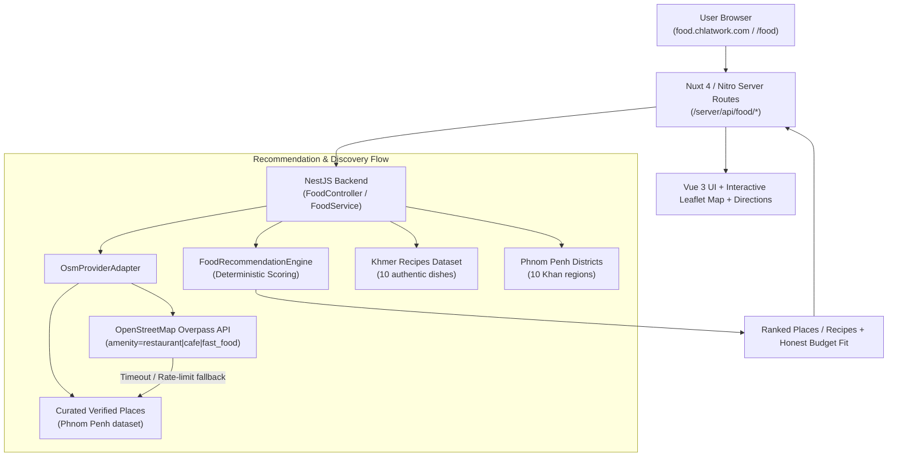

# ChlatWork Food (ឆ្លាតវើក ហ្វូត)

> Tagline: **"ញ៉ាំអី? ទៅណា? ធ្វើម្ហូបអី?"**  
> Subdomain: `food.chlatwork.com` (and `/food` on main domain)

---

## 1. Overview & Philosophy

ChlatWork Food is a **100% FREE-first, Khmer-first, mobile-first food discovery platform** integrated directly within the existing ChlatWork monorepo. It solves the everyday dilemma of deciding what to eat, where to dine out, or what Khmer meal to cook at home—tailored to party size, occasion, and real budget.

### Core Principles
1. **Zero Paid APIs / Zero Paid AI**: No Google Places, no Google Maps API, no paid LLMs, and no commercial third-party keys.
2. **Deterministic Recommendation Engine**: Transparent, reproducible rule-based scoring based on meal time, occasion, party size, budget, and location proximity.
3. **Honest Price Data Policy**: Never claims a restaurant fits a user's budget without verified pricing data. Unverified spots are explicitly marked as `តម្លៃមិនទាន់ផ្ទៀងផ្ទាត់ (Price not verified)`.
4. **Authentic Khmer Culture**: Native Khmer language UI, authentic traditional recipes (Samlor Korko, Amok, Lok Lak, Bai Sach Chrouk, Nom Banh Chok, etc.), and local Phnom Penh district mappings.
5. **OpenStreetMap & ODbL Compliance**: Full attribution, compliant tile usage, and respectful querying of public Overpass infrastructure.

---

## 2. Architecture & Data Flow



---

## 3. Data Providers & Policy Compliance

| Provider / Layer | Purpose | Cost | Compliance & Policy Details |
| :--- | :--- | :--- | :--- |
| **OpenStreetMap Overpass API** | Live search for nearby restaurants, cafés, fast food | Free | Query throttling (min 1s interval), 15-minute in-memory caching to eliminate keystroke spam, 8s timeout with graceful fallback to curated places. Mandatory ODbL 1.0 attribution on UI and API responses. |
| **OpenStreetMap Tile Server** | Interactive map rendering via Leaflet | Free | Modest usage policy compliant. Displaying visible `© OpenStreetMap contributors` copyright badge linking to `https://www.openstreetmap.org/copyright`. No bulk tile downloading. |
| **Browser Geolocation API** | Locating user near dining spots | Free | Explicit user permission required. Graceful fallback to Phnom Penh district selection or city center (`11.5564, 104.9282`) if denied. |
| **Curated Places Dataset** | Verified Phnom Penh spots with confirmed pricing & features | Free | Locally maintained dataset with confirmed pricing (`isPriceVerified: true`) to ensure honest budget calculations. |
| **Khmer Recipes Dataset** | Traditional home cooking guide | Free | 10 locally maintained authentic Khmer dishes with ingredients, steps, timings, portions, and budget estimates. |

---

## 4. Recommendation Scoring Engine

The recommendation engine (`FoodRecommendationEngine`) scores places deterministically:

1. **Meal Time Suitability** (e.g., breakfast prioritizes noodle/congee/café; dinner prioritizes BBQ/hotpot/restaurants).
2. **Occasion & Group Size**:
   - `solo`: Cafés, quick eats, takeaway.
   - `friends`: Group-friendly dining, BBQ, hotpot, food courts.
   - `first-date` / `couple`: Romantic ambiance, quiet, air-conditioned seating.
   - `family` / `elderly`: Family-friendly, wheelchair accessible, comfortable dining.
3. **Budget Fit**:
   - Compares estimated price per person (`totalBudget / peopleCount`) with `estimatedPricePerPersonUsd`.
   - If pricing is verified and within budget: +20 points + exact savings explanation.
   - If pricing is verified and exceeds budget: -15 points + explanation of difference.
   - **If pricing is unverified**: 0 points (neutral) and labeled as `"តម្លៃមិនទាន់ផ្ទៀងផ្ទាត់ (Price not verified)"` with zero false claims.
4. **Distance Proximity**:
   - Haversine formula calculates exact distance:
     - $\le 800\text{m}$: +25 points
     - $\le 1.5\text{km}$: +15 points
     - $\le 3\text{km}$: +8 points

---

## 5. API Endpoints

All endpoints are hosted under `/food` in the NestJS API and proxied via `/api/food/*` in Nuxt:

- `GET /api/food/search?lat=&lng=&radius=&cuisine=&district=`: Search nearby dining spots.
- `POST /api/food/recommend`: Request smart recommendations based on mode, meal time, occasion, people count, and total budget.
- `GET /api/food/recipes`: List authentic Khmer recipes with optional category filter.
- `GET /api/food/recipes/:id`: Detailed ingredients and step-by-step instructions for a single recipe.
- `GET /api/food/random?mealTime=`: "រើសឱ្យខ្ញុំមួយ!" Random food or restaurant picker.
- `GET /api/food/districts`: List of Phnom Penh Khan districts with geographical coordinates.

---

## 6. Subdomain Routing & Deployment

Food discovery is registered in the existing single-deployment product domain architecture:

- In `app/lib/product-domains.ts`:
  ```typescript
  food: { name: "ChlatWork Food", entry: "/food", home: "/", host: "food" }
  ```
- Subdomain Rollout Environment Variables:
  ```env
  NUXT_PUBLIC_DOMAINS_ENABLED_PRODUCTS=food
  NUXT_PUBLIC_DOMAINS_CANONICAL_PRODUCTS=food
  NUXT_PUBLIC_DOMAINS_REDIRECT_PRODUCTS=food
  ```
- DNS Configuration:
  - CNAME `food.chlatwork.com` pointing to `cname.vercel-dns.com`.
  - Reuses the existing Vercel deployment; no new hosting project required.

---

## 7. Limitations of Free Public Services

1. **Overpass Server Capacity**: Overpass public servers occasionally experience high global load or brief rate limits (HTTP 429). The system handles this gracefully by automatically falling back to curated local places without interrupting the user experience.
2. **OpenStreetMap Tile Capacity**: The standard OSM tile server is intended for modest map views. If traffic scales significantly in the future, a dedicated vector tile source or self-hosted tile cache can be configured without changing application code.
